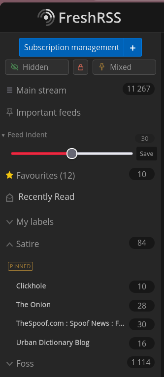

<h1 align="center">FreshRSS extensions</h1>

<em>Small, self-contained extensions for a self-hosted <a href="https://freshrss.org">FreshRSS</a>. 
No telemetry, no accounts, no external services. Everything runs on your own instance.</em>

---

## Category control

Two extensions that manage what your sidebar shows. They do different jobs and are
designed to be installed together.

### [Hidden Categories](https://github.com/dilroopg/xExtension-HiddenCategories)

Put categories away without unsubscribing. No sidebar row, no articles in the main
stream, feeds keep updating. One eye button cycles **Hidden** → **Shown** → **Just hidden**.

- **Light** filters in the browser and writes nothing.
- **Strict** hides those feeds on every synced client — phone, reader apps — by writing
  `feed.priority`, with a snapshot restored when you unhide.
- Optional passcode lock.

### [Favorite Categories](https://github.com/dilroopg/xExtension-FavoriteCategories)

Filter your sidebar down to the categories you actually read. One button cycles
**Mixed** → **Just Favorites** → **Hide Favorites**. A settings dropdown swaps the star for a
pushpin and the wording to **Just Pinned** / **Hide Pinned**. Favorited categories sort to the top
and carry a badge, with their original order restored when unfavorited.

- **Light** is a browser filter; the only thing written is a category's display position.
- **Strict** rewrites feed visibility for the selected categories vs. everything else.

> **Using both?** They share `feed.priority`, and they stay out of each other's way by
> design: Favorite Categories never selects a row Hidden has hidden, so a category that is
> both hidden and favorited stays hidden. In Strict, neither writes to a feed the other one
> owns. Their buttons share one row above the sidebar.

---

## Feed settings

### [Right Click Actions - Feed Settings Panel](https://github.com/dilroopg/xExtension-RightClickActions-FeedSettingsPanel)

Open a feed's settings in a floating panel over the page you are on, instead of
navigating away — so your reading position survives the edit. Requires
[Right Click Actions](https://github.com/featurecreep-cron/freshrss-extensions/tree/main/xExtension-RightClickActions).

Beyond the fields, it can run the feed's actions in place: **update now**, **reload
articles**, **delete all articles**, **export OPML**, **remove feed** — each one
switchable, each reporting back in the panel while it works.

---

## Feeds that have no RSS

### [pol-ler Sites](https://github.com/dilroopg/freshrss-poller-sites)

Scrape sites that publish no feed at all. Teach it a site once — a URL pattern and one
template feed — then add any person or page on that site by name and get a working
subscription, filed in its own category.

Standalone: it needs no other FreshRSS extension. It does need a
[self-hosted pol-ler](https://github.com/dilroopg/pol-ler) instance on the same Docker
network — see the repo for setup. That repo is a small fork of upstream pol-ler adding
`FEED_URL_BASE` so the subscribe link resolves from inside a container; upstream works too.

---

## Sidebar

### [Sidebar Feed Indent](https://github.com/dilroopg/xExtension-SidebarIndent)

Feed rows sit flush against the sidebar edge, which leaves the feed name jammed
against the window and a long way from its unread count on the right. This adds a
small left indent, controlled by a slider that lives **in the sidebar itself**,
directly under the **Important feeds** row — and starts collapsed, so it is one
quiet line until you open it.

- Dragging the slider moves the indent live, against your actual feeds. **Save** stores it.
- The indent applies to feed rows only: category rows, tags and the main stream are untouched.
- Writes nothing — one CSS custom property and one rule on `#aside_feed`.

[Download 1.0.0](https://github.com/dilroopg/xExtension-SidebarIndent/releases/tag/v1.0.0) ·
[Changelog](https://github.com/dilroopg/xExtension-SidebarIndent/blob/master/CHANGELOG.md)

---

## Browser extension

### [Add to FreshRSS](https://github.com/dilroopg/add-to-freshrss)

Right-click any link or page and subscribe it to your FreshRSS — no copy-pasting URLs
into the web UI. Firefox, Manifest V3, no build step, no dependencies.

It talks only to the instance you configure. Your URL and API password live in browser
storage, so read the code before trusting it; there is a short disclosure at the top of
that repo.

---

## Notes

- Each extension is installed independently: drop the folder in `extensions/` and enable
  it in **Settings → Extensions**, or use Extension Manager.
- All of these are GPL-3.0 and work against a self-hosted instance you control.
- They were written with AI assistance, directed and tested by hand. That is worth
  knowing before you install one — read the source, and back up
  `data/users/<user>/db.sqlite` first.

## License

Each repository carries its own license (GPL-3.0 unless noted). See the individual
repos for terms and changelogs.
